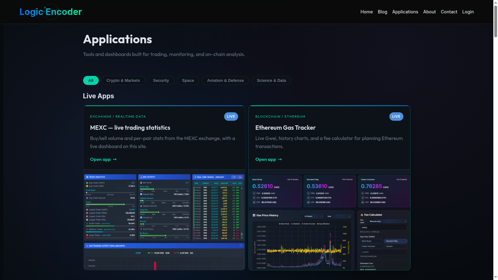

# LE Shop — WordPress Product Catalogue

A software store needs an editorial place to explain products as well as a way to sell them. LE Shop lets the operator maintain application pages and sales information in WordPress while keeping the catalogue connected to the Crypto App Store purchase experience.

## Tech stack

| Layer | Technologies |
|---|---|
| Application | PHP, WordPress |
| Supporting technologies | HTML, CSS, JavaScript |

## Publish applications as products

Applications are a dedicated content type in WordPress, listed under an **Applications** menu with Add New and All Applications screens. Each application has a title, a rich description in the normal editor, a featured image and an excerpt, and the catalogue has a public archive page, so every product gets a consistent address and the whole range can be browsed in one place. The content type is also available through the WordPress REST interface, which lets other parts of the site list products without copying them.

Editing stays in the familiar WordPress workflow: draft a product, preview it, publish it, and unpublish it when it is withdrawn. A product page is where the story belongs (what the tool does, who it is for, screenshots); the sales fields beside it carry the facts.

## Keep sales information together

Below the editor a product details box holds the facts a buyer and the store both need:

- **Price** in dollars.
- **Version** and **Last update date**, so a release is visible to buyers.
- **Status**: active, beta, live, unstable or old, which tells buyers how mature the build is.
- **Size**, for example 2.4 MB, shown before downloading.
- **Badge**: Hot, New, Sad or Old, a one-word label on the product card.
- **Requirements**, in plain text.
- **File ID**: the number of the downloadable archive in the warehouse (for example 530 for `530.zip`), which links the page to the deliverable.

Because everything lives with the page, a release is an edit of a few fields rather than a rebuild of the catalogue.

## Check catalogue readiness

The plugin's dashboard and its item and warehouse views compare what is published on the website with what the connected store can actually deliver. A product whose file ID has no matching archive, or whose status or version disagrees with the warehouse, is visible before it is announced. Live-fetch controls read the current state from the store on demand, so the check reflects the present moment rather than a stored copy.

A practical routine: prepare the product page, set its file ID, open the dashboard, confirm that the file is available and the details match, then publish.

## Connect publishing and shopping

When an application is published, updated or changes status, the plugin notifies the store backend, so the buyer-facing shop reflects the change without a second round of editing. The notification is signed with a shared webhook secret that the store verifies. Shop and item links open the right product directly in Telegram, through a bot deep link configured once for the site.

The plugin's role is the catalogue: it holds product information and publishes it. Payment, order handling and file delivery belong to the connected store.

## Maintain the integration

The settings screen, available to administrators, holds the store address, the webhook secret, an administrator API key for the store, the bot deep link and the bot username. A **Test webhook** button sends a test notification and reports whether the store answered, which is the first thing to try when a change does not appear in the shop. Saving settings is restricted to users who can manage the site's options.

When something looks wrong, work from the dashboard: compare the product page with its warehouse entry, test the webhook, then re-check the buyer-facing listing.

---

Private code: [le-shop-plugin](https://github.com/logicencoder/le-shop-plugin)

See [REPOS.md](REPOS.md) for related repositories.

**[Logic Encoder](https://logicencoder.com)** · [GitHub](https://github.com/logicencoder) · [Contact](https://logicencoder.com/contact/)
